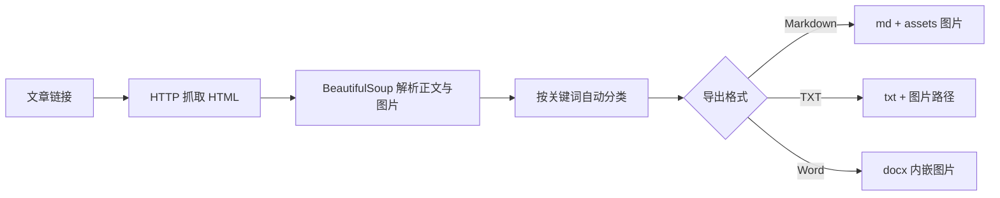

<div align="center">

# url2markdown

粘贴文章链接，自动抓取正文与图片，按分类保存为 **Markdown / TXT / Word(docx)** 文件。

[](https://www.python.org/)
[](#快速开始)
[](LICENSE)

[快速开始](#快速开始) · [使用步骤](#使用步骤) · [导出格式](#导出格式对比) · [配置](#配置) · [故障排查](#故障排查) · [免责声明](#免责声明) · [许可证](#许可证)

</div>

---

带图形界面的桌面小工具，双击即用，无需安装 Python。针对政策新闻、微信公众号等文字文章优化：自动识别 GBK/UTF-8 编码、智能合并段落避免错行、提取正文图片、按关键词自动分类存放。

> [!NOTE]
> 网页结构会调整，部分站点的正文或图片解析规则可能需要同步更新。若某类页面抓取不理想，欢迎反馈链接以便补充规则。

## 功能特性

- 三种导出格式：**Markdown**（图片相对路径引用）、**TXT**（纯文本 + 图片路径）、**Word / docx**（图片直接内嵌）
- 正文图片自动下载到 `assets/` 文件夹（支持微信 `data-src` 防盗链）
- 自动识别网页标题层级，还原一、二级标题结构
- 智能段落合并：加粗 / 链接 / span 等行内标签不会把一句话拆成多行
- 自动过滤资产引用、孤立括号、点赞分享等噪音
- 按关键词归类到 政治 / 经济 / 科技 / 社会 / 法治 / 国际 / 其他 子文件夹
- 支持一次粘贴多个链接批量抓取，后台线程处理不卡顿
- 保存目录可自选，默认系统桌面

## 工作流程



## 快速开始

### 方式 A：下载 exe（推荐）

从 [Releases](https://github.com/acejaiy/url2markdown/releases) 下载 `网页转Markdown.exe`，双击打开即可使用，无需 Python 环境。

> 提示：exe 未做代码签名，首次运行可能触发 Windows SmartScreen 提示，选择「更多信息 → 仍要运行」即可。

### 方式 B：源码运行

需要 Python 3.10+（官方 CPython，自带 tkinter）：

```bash
git clone https://github.com/acejaiy/url2markdown.git
cd url2markdown
pip install -r requirements.txt
python gui.py
```

> 注意：部分精简版 Python 不带 tkinter，无法运行 GUI，请使用官方发行版。

## 使用步骤

1. 把文章链接粘贴到文本框（多个链接每行一个）
2. 选择保存位置（默认系统桌面）
3. 选择保存格式、分类方式，按需勾选图片下载
4. 点击「开始抓取并保存」，日志区实时显示进度
5. 完成后点击「打开保存文件夹」查看结果

输出结构示例：

```
桌面/
└── 科技/
    ├── 文章标题.md
    └── assets/
        ├── 文章标题_01.jpg
        └── 文章标题_02.jpg
```

## 导出格式对比

| 格式 | 图片处理 | 适合场景 |
| --- | --- | --- |
| Markdown | `` 相对路径引用 | 笔记软件、静态博客、GitHub |
| TXT | `[图片：assets/xxx.jpg]` 路径标注 | 纯文本存档 |
| Word (docx) | 图片内嵌进文档，标题用 Word 标题样式 | 分享、打印、二次编辑 |

## 配置

所有可调项集中在 `config.py`：

| 配置项 | 作用 |
| --- | --- |
| `CATEGORIES` | 分类名及对应关键词，决定文章归入哪个文件夹 |
| `DEFAULT_CATEGORY` | 未命中关键词时的兜底分类（默认「其他」） |
| `INCLUDE_METADATA` | 是否在文首输出来源 / 作者 / 时间 / 原文链接 |
| `REQUEST_TIMEOUT` | 抓取超时秒数 |

## 打包 exe

Windows 下双击 `build.bat`，脚本会自动探测带 tkinter 的 Python 并调用 PyInstaller 生成 `dist/网页转Markdown.exe`。

手动执行：

```bash
pip install pyinstaller
python -m PyInstaller build.spec --noconfirm
```

## 项目结构

| 文件 | 作用 |
| --- | --- |
| `gui.py` | 图形界面入口（主程序） |
| `fetcher.py` | 抓取网页，提取正文、元信息与正文图片 |
| `classifier.py` | 基于关键词打分的自动分类 |
| `md_builder.py` | 渲染 Markdown / TXT / DOCX |
| `saver.py` | 下载图片到 assets、建分类文件夹、保存文件 |
| `config.py` | 可配置项 |
| `test/` | 真实抓取示例（三种格式 + assets 图片） |
| `main.py` / `exe_main.py` / `siyuan.py` | 早期命令行 / 思源版遗留，GUI 版不使用 |

## 故障排查

### 抓取失败或正文为空

- 确认链接可直接访问，且是公开文章（无需登录）。
- 部分站点有反爬机制，稍后重试、降低抓取频率，或更换网络。
- 若站点正文由 JavaScript 动态渲染，当前基于静态 HTML 的解析可能取不到，欢迎反馈链接。

### 图片下载失败或缺失

- 微信图片依赖 `qpic.cn` 等 CDN，确认网络可访问这些域名；公司代理或防火墙可能拦截。
- 少数图片带防盗链，程序已携带 Referer 尝试绕过，仍失败时可单独保存。

### GUI 无法启动

- 源码运行请使用官方 CPython（自带 tkinter），精简版可能缺少 tkinter。
- exe 若被 SmartScreen 拦截，选择「更多信息 → 仍要运行」。

## 免责声明

- 本工具仅供个人学习与合法研究使用，请遵守目标网站的服务条款与 robots.txt 约定。
- 仅抓取、保存你有权访问的公开内容；下载内容的版权归原作者所有，使用者应对其后续使用承担全部责任。
- 请勿用于高频抓取、批量采集、绕过平台访问控制或任何违反法律法规与平台规则的用途。
- 工具按「现状」提供，不保证对任何网站的抓取效果持续有效；网页结构变化可能导致解析失效。
- 因使用本工具产生的任何直接或间接损失、法律责任，由使用者自行承担，作者不承担任何责任。

## 许可证

本项目基于 [MIT License](LICENSE) 开源。你可以自由使用、复制、修改与分发，但须保留原始版权声明与许可证文本。详见 [LICENSE](LICENSE) 文件。
