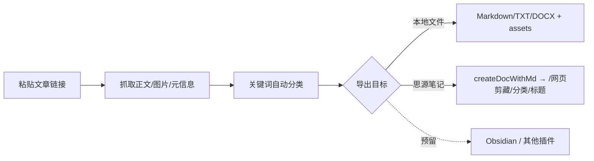

<div align="center">

# 网页转文件 · 剪藏助手

**V1.1.0-preview.1 · GitHub 预览版**

粘贴文章链接，抓取正文与图片，导出为 **Markdown / TXT / Word**，或一键剪藏到 **思源笔记**。

[](https://www.python.org/)
[](#快速开始)
[](#版本说明)
[](LICENSE)

[快速开始](#快速开始) · [思源笔记设置](#思源笔记设置小白三步) · [工作流程](#工作流程) · [高阶扩展](#高阶用户扩展入口) · [故障排查](#故障排查) · [免责声明](#免责声明) · [许可证](#许可证)

</div>

---

> [!NOTE]
> 这是 **V1.1.0 预览版**，已发布到 GitHub。V1.0.0 的内容与提交历史完整保留；本版本在原有基础上新增思源笔记剪藏与更简易的配置流程。

## 版本说明

| 版本 | 状态 | 主要内容 |
| --- | --- | --- |
| V1.0.0 | 已发布 | URL → Markdown / TXT / DOCX，自动分类，图片入 assets |
| **V1.1.0-preview.1** | **预览版（已发布）** | 新增思源笔记剪藏目标、一次性配置、目标适配器架构、GUI 简化 |

## V1.1.0 新增了什么

- **剪藏至思源笔记**：作为可选导出目标，与本地文件可同时勾选。
- **一次设定，长期使用**：API 地址、笔记本、Token、路径前缀在 GUI 中设置并保存到本机配置文件；以后点「更改思源笔记配置」即可修改。
- **小白友好**：默认 API `http://127.0.0.1:6806`，点「① 测试连接」后程序自动列出你的笔记本，下拉选中即可，**无需手动复制 ID**；保存后弹出「✓ 配置成功！」确认界面。
- **GUI 细节优化**：文章链接框支持 Ctrl + Enter 换行；本地选项文案更清晰（「按文章分类建子文件夹」）；配置窗口按内容自适应高度，按钮不会被裁切。
- **高阶入口**：`destinations/` 目标适配器目录，为后续思源插件、Obsidian 插件预留；`config.py` / `settings.py` / `siyuan_client.py` 均可直接改；万一自动列表失效可勾选「手动填 ID」。
- **GUI 简化**：字体加大，流程改为「① 粘贴链接 → ② 选择目标 → ③ 点开始」。

## 工作流程



## 快速开始

### 方式 A：源码运行

需要 Python 3.10+ 官方 CPython（自带 tkinter）：

```bash
git clone https://github.com/acejaiy/url2markdown.git
cd url2markdown
git checkout v1.1.0-preview   # 切换到 V1.1.0 预览版分支；main 是 V1.0.0
pip install -r requirements.txt
python gui.py
```

自检窗口组件：

```bash
python gui.py --selftest
```

### 方式 B：下载 exe

到 [Releases](https://github.com/acejaiy/url2markdown/releases) 下载对应版本，双击运行即可，无需安装 Python。

> exe 未做代码签名，首次运行可能触发 Windows SmartScreen，选择「更多信息 → 仍要运行」。

### 方式 C：本地打包 exe

双击 `build.bat`，生成：

```
dist/网页转文件-剪藏助手-V1.1.0预览版.exe
```

## 使用步骤（小白版）

1. 打开程序，在「① 文章链接」中粘贴链接（多个链接每行一个，支持 Ctrl + Enter 换行）。
2. 在「② 导出到」勾选目标：
   - **保存为本地文件**：默认桌面，可改目录、格式、分类方式。
   - **剪藏至思源笔记**：首次勾选会弹出配置窗口。
3. 点击「开始」，日志区会显示每一步结果。
4. 若勾选了本地文件，完成后可点「打开保存文件夹」。

## 思源笔记设置（小白三步）

> 无需手动找笔记本 ID：程序会自动从思源拉取笔记本列表，你只需下拉选中即可。

1. 确认思源已启动。默认 API 地址就是 `http://127.0.0.1:6806`，**一般不用改**。
   - 如果你改过端口：把 `6806` 换成思源实际端口即可，例如 `http://127.0.0.1:6807`。
2. 在 GUI 中点击「更改思源笔记配置」，点「① 测试连接」。
   - 连接成功后，窗口会自动列出你所有的笔记本；在「② 选择笔记本」的下拉框里选中目标笔记本即可。
   - 选中后窗口会显示「✓ 已选中笔记本「XXX」」，ID 由程序自动读取，无需你手动复制。
3. 点「② 确认并保存」。保存后会弹出「✓ 配置成功！」界面，显示目标笔记本与保存路径，确认无误后点「完成」即可。

- 说明：思源笔记本的右键菜单里**没有**「复制笔记本 ID」选项（那是子文档的），所以本版本改为自动列出笔记本让你选。
- 高阶用户：若自动列表因网络等原因没出现，可勾选「手动填 ID」自行粘贴笔记本 ID。

保存后，文章会写入：

```
/网页剪藏/<自动分类>/<文章标题>
```

例如：`/网页剪藏/科技/人工智能赋能产业创新`。

以后如果要换笔记本或端口，再点「更改思源笔记配置」即可。

## 思源 API 说明（简单版）

| 项目 | 默认值 | 是否需要改 |
| --- | --- | --- |
| API 地址 | `http://127.0.0.1:6806` | 一般不用；改过端口才改 |
| 笔记本 | 空 | **测试连接后下拉选中一次** |
| API Token | 空 | 本机使用不用；远程/鉴权才填 |
| 路径前缀 | `/网页剪藏` | 可改成你喜欢的目录 |
| 使用的接口 | `/api/notebook/lsNotebooks`、`/api/filetree/createDocWithMd` | 无需关心 |

> 图片默认保留原图链接写入思源，成功率最高；实验性上传资产可在 `config.py` 中开启 `SIYUAN_UPLOAD_IMAGES = True`。

## 导出目标与图片策略

| 目标 | 图片处理 | 适合场景 |
| --- | --- | --- |
| 本地 Markdown | 下载到 `assets/`，相对路径引用 | 笔记软件、静态博客、归档 |
| 本地 TXT | `[图片：assets/xxx.jpg]` 路径标注 | 纯文本存档 |
| 本地 Word (DOCX) | 图片内嵌进文档 | 分享、打印、二次编辑 |
| 思源笔记 | 默认保留原图 URL；可选上传 assets | 本地知识库剪藏 |

## 高阶用户扩展入口

V1.1.0 把导出逻辑从 GUI 中拆出，方便后续升级：

- `destinations/base.py`：统一接口 `BaseDestination` 与 `ExportOptions`。
- `destinations/local_files.py`：本地文件适配器。
- `destinations/siyuan.py`：思源适配器（图片策略、同名文档策略都在这里）。
- `destinations/obsidian.py`：**Obsidian 预留入口**，默认不显示勾选框。
- `destinations/registry.py`：注册中心；新增适配器后用 `@register` 即可。
- `config.py` → `DESTINATION_ORDER`：控制 GUI 中目标显示顺序。
- `settings.py`：默认配置与本机 JSON 配置路径。
- `siyuan_client.py`：独立 API 客户端，可单独调用或替换。
- 旧版 `siyuan.py` 保留为按“笔记本名称”写入的参考实现，`main.py` / `exe_main.py` 仍可使用。

详细说明见 [`destinations/README.md`](destinations/README.md)。

## 配置

普通用户只需在 GUI 中配置；高阶用户可改 `config.py`：

| 配置项 | 作用 |
| --- | --- |
| `SIYUAN_API_BASE` | 默认思源 API 地址 |
| `SIYUAN_PATH_PREFIX` | 思源文档路径前缀，默认 `/网页剪藏` |
| `SIYUAN_UPLOAD_IMAGES` | 实验性：上传图片到思源 assets |
| `SIYUAN_ADD_TIME_SUFFIX` | 同名文档追加时间戳 |
| `CATEGORIES` / `DEFAULT_CATEGORY` | 分类关键词与兜底分类 |
| `INCLUDE_METADATA` | 是否输出来源/作者/时间/原文链接 |
| `REQUEST_TIMEOUT` | 抓取超时秒数 |
| `DESTINATION_ORDER` | GUI 目标显示顺序与扩展入口 |

GUI 设置保存在本机配置文件（不会进仓库）：

- Windows：`%APPDATA%/url2markdown-preview/settings.json`
- 其他：`~/.config/url2markdown-preview/settings.json`

## 项目结构

| 文件/目录 | 作用 |
| --- | --- |
| `gui.py` | V1.1.0 GUI 入口（简化流程 + 思源配置窗口） |
| `fetcher.py` | 抓取网页，提取正文、元信息与图片 |
| `classifier.py` | 关键词打分自动分类 |
| `md_builder.py` | 渲染 Markdown / TXT / DOCX 块 |
| `saver.py` | 下载图片到 assets、保存本地文件 |
| `siyuan_client.py` | **新增** 思源 HTTP API 客户端 |
| `settings.py` | **新增** 本机配置持久化 |
| `destinations/` | **新增** 导出目标适配器目录（含 Obsidian 预留） |
| `config.py` | 全局默认配置与扩展开关 |
| `CHANGELOG.md` | **新增** V1.0.0 → V1.1.0-preview.1 完整更新日志 |
| `PREVIEW_NOTES.md` | **新增** 预览版说明、待确认事项与验证清单 |
| `tools/write_changelog_to_siyuan.py` | **新增** 把更新日志按分类写入思源的脚本 |
| `build.spec` / `build.bat` | 预览版 exe 打包脚本 |
| `test/` | V1.0.0 真实抓取示例 |
| `main.py` / `exe_main.py` / `siyuan.py` | 早期命令行/思源版遗留，GUI 不使用 |

## 故障排查

### 思源测试连接失败

- 确认思源已启动，且「设置 → 关于」中显示的端口与 GUI 中一致。
- 本机使用不需要 Token；若填了 Token，确认格式正确。
- 若提示笔记本 ID 失效，重新点「① 测试连接」拉取列表，再在「② 选择笔记本」重新选中；或勾选「手动填 ID」。

### 抓取失败或正文为空

- 确认链接可直接访问，且是公开文章（无需登录）。
- 部分站点有反爬机制，稍后重试或更换网络。
- JS 动态渲染页面可能取不到正文，当前基于静态 HTML 解析。

### 图片缺失

- 微信图片依赖 CDN，公司代理可能拦截；本地 Markdown 会下载到 `assets/`。
- 思源目标默认保留原图 URL；离线打开思源时可能看不到远程图片，可开启资产上传实验选项。

### GUI 无法启动

- 源码运行请使用官方 CPython（自带 tkinter）。
- exe 若被 SmartScreen 拦截，选择「更多信息 → 仍要运行」。

## 免责声明

- 本工具仅供个人学习与合法研究使用，请遵守目标网站的服务条款与 robots.txt 约定。
- 仅抓取、保存你有权访问的公开内容；下载内容的版权归原作者所有，使用者应对其后续使用承担全部责任。
- 请勿用于高频抓取、批量采集、绕过平台访问控制或任何违反法律法规与平台规则的用途。
- 写入思源笔记属于用户本地行为，请自行确认目标笔记本与路径，避免覆盖重要资料。
- 工具按「现状」提供，不保证对任何网站或思源版本的接口持续兼容。
- 因使用本工具产生的任何直接或间接损失、法律责任，由使用者自行承担，作者不承担任何责任。

## 许可证

本项目基于 [MIT License](LICENSE) 开源。你可以自由使用、复制、修改与分发，但须保留原始版权声明与许可证文本。详见 [LICENSE](LICENSE) 文件。
